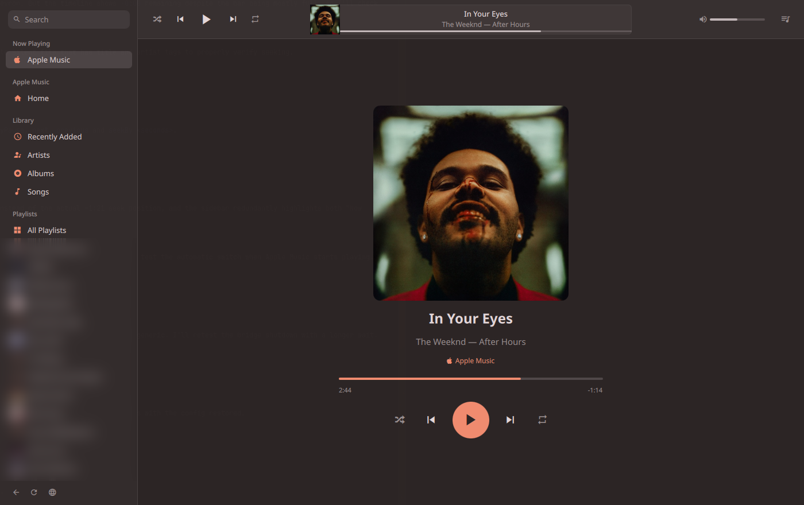

<p align="center">
  
</p>

<h1 align="center">OmAmp</h1>

A music player for the Omarchy bar. OmAmp puts the current song in your bar
with a slim popup for quick control, and pops out into a full player window. It
works with **any player that supports MPRIS** — Spotify, Tidal, Amazon Music,
Audible, YouTube Music, or a web player in your browser — and goes further with
**Apple Music**: Up Next queue, library, playlists, search, album and artist
pages. It follows your Omarchy theme colors live.


<p>
  
  
</p>

## What works with which service

| | Any MPRIS player (Spotify, Tidal, Amazon Music, Audible, YouTube Music, browsers…) | Apple Music |
|---|:---:|:---:|
| Song, artist, album, cover in the bar and popup | ✅ | ✅ |
| Play/pause, previous, next | ✅ | ✅ |
| Timeline and seeking | ✅ if the player supports it | ✅ |
| Shuffle, repeat, volume | ✅ if the player supports it | ✅ |
| Switch between playing sources | ✅ | ✅ |
| Up Next queue | — | ✅ |
| Library, playlists, search, album/artist pages | — | ✅ |

How to get each service onto MPRIS:

- **Spotify:** the official `spotify` app, or open.spotify.com in a browser.
- **Tidal:** the `tidal-hifi` app, or listen.tidal.com in a browser.
- **Amazon Music, Audible, YouTube Music, Deezer, SoundCloud…:** their web
  players in Chromium, Brave, Firefox and other browsers publish MPRIS
  automatically.
- **Local players** such as mpv (with `mpv-mpris`) work too.

OmAmp recognizes Spotify, Tidal, Amazon Music, Audible, YouTube, Deezer and
SoundCloud by name, including web players inside a browser. Any other player
appears under its own name.

## Features

- **Bar widget:** play state and a scrolling title / artist.
- **Slim popup** (left-click):
  - The active source at the top; click it to switch between sources.
  - Cover art, title, a draggable timeline (scroll to seek), and
    shuffle / previous / play-pause / next / repeat.
  - Apple Music: Up Next shows three songs at a time; scroll (mouse wheel,
    scrollbar, or the keys below) to see the rest of the queue, and click a
    song to jump to it.
  - Keys while the popup is open: <kbd>↑</kbd>/<kbd>↓</kbd> scroll Up Next by
    one song, <kbd>PgUp</kbd>/<kbd>PgDn</kbd> by three, <kbd>Home</kbd>/<kbd>End</kbd>
    to the start/end, <kbd>Space</kbd> play/pause, <kbd>Esc</kbd> close.
  - Nothing playing: buttons to open Apple Music, Spotify, Tidal, Amazon Music,
    Audible or YouTube Music.
- **Pop-out player** (right-click, or the ⤢ button in the popup):
  - **Now Playing** page for any source, plus every live source in the sidebar
  - Apple Music: Home (recently played and recommendations), Recently Added,
    Artists, Albums, Songs, all your playlists, search across the catalog or
    your library, album / playlist / artist pages with Play / Shuffle, the Up
    Next drawer, and a right-click menu (Play, Shuffle, Play Next, Play Last)
  - Keys: <kbd>Space</kbd> play/pause, <kbd>Ctrl</kbd>+<kbd>F</kbd> search,
    <kbd>Ctrl</kbd>+<kbd>←</kbd>/<kbd>→</kbd> previous/next,
    <kbd>Alt</kbd>+<kbd>←</kbd> back
- **Middle-click** the bar widget to play/pause.
- **Automatic source:** the most recently started player becomes active; a
  source you pick yourself stays active until another player starts.

### IPC and keybindings

```bash
omarchy-shell omamp togglePopup     # open/close the slim popup
omarchy-shell omamp openPlayer      # open the pop-out
omarchy-shell omamp playPause
omarchy-shell omamp next
omarchy-shell omamp previous
omarchy-shell omamp seekBy 10       # seconds; negative seeks back
```

The pop-out can open straight to a page:
`omarchy-shell shell summon io.github.v-eagle.omamp '{"nav":{"view":"nowplaying"}}'`
or, for Apple Music,
`omarchy-shell shell summon io.github.v-eagle.omamp '{"search":"Daft Punk"}'`.

## Requirements

- Omarchy 4 (the Quickshell-based shell) on Hyprland 0.56+
- For other services: nothing extra, only a player that supports MPRIS
- For Apple Music:
  - an Apple Music subscription
  - `chromium` (preferred; `google-chrome-stable` or `brave` also work).
    Chromium downloads the Widevine DRM module Apple Music needs on first run.
  - `python3` (standard library only)

## Install

```bash
omarchy plugin add https://github.com/V-EAGLE/omamp.git --enable
```

The widget appears on the right of your bar; move it with
`omarchy bar move io.github.v-eagle.omamp --section <left|center|right>`.

### Settings

Set these on the widget's entry in `~/.config/omarchy/shell.json` (or in the
bar settings):

| Setting | Default | |
|---|---|---|
| `appleMusic` | `true` | Apple Music integration. Set to `false` if you don't use Apple Music: OmAmp then never starts the Apple bridge or Chromium. |
| `maxLabelWidth` | `180` | Max width of the scrolling title in the bar (px; `0` hides it). |

### Apple Music first run

Click the widget and choose **Apple Music**. A web player window opens; sign
in to Apple Music there. Once you're signed in, OmAmp moves that window to a
hidden workspace (`special:applemusic`). The 🌐 button in the popup or pop-out
shows it again (for other sources it raises that player's window).

### Optional: launcher entry

To open the pop-out from the <kbd>Super</kbd>+<kbd>Space</kbd> menu by searching
"OmAmp", create a desktop entry (plugins can't install one themselves):

```bash
cat > ~/.local/share/applications/omamp.desktop <<EOF
[Desktop Entry]
Type=Application
Name=OmAmp
GenericName=Music Player
Keywords=omamp;music;player;apple;spotify;tidal;amazon;audible;
Exec=omarchy-shell shell summon io.github.v-eagle.omamp {}
Icon=$HOME/.config/omarchy/plugins/io.github.v-eagle.omamp/omamp.svg
Categories=AudioVideo;Audio;Player;
EOF
```

## How it works

- **Every service:** `Service.qml` reads all MPRIS players through Quickshell's
  `Quickshell.Services.Mpris` and controls the active one directly. Nothing is
  launched and no network is used for this.
- **Apple Music:** there is no Apple Music app for Linux, so OmAmp runs
  [music.apple.com](https://music.apple.com) as a Chromium web app and controls
  it. `amctl.py` launches Chromium with its own profile and the DevTools
  protocol enabled on `127.0.0.1:9339`, then drives the page's MusicKit player
  (play, seek, queue, library and catalog requests). That browser also
  publishes MPRIS, so OmAmp hides it to avoid a duplicate entry.
- `BarWidget.qml` (slim popup) and `Player.qml` (pop-out) bind to the active
  source's state from `Service.qml`.
- The service launchers open the `spotify` or `tidal-hifi` app when installed,
  otherwise the service's web player via `omarchy-launch-webapp`.

On the very first Apple Music start Chromium downloads the Widevine DRM module
in the background; until it's loaded Apple Music only plays 90-second previews.
OmAmp detects this and restarts the web player once, automatically, as soon as
Widevine is available.

Chromium keeps running when the shell restarts, so playback isn't interrupted.
**Closing the Apple Music web player window stops the music.**

## Security and privacy

- Plugins run unsandboxed inside the Omarchy shell.
- MPRIS control stays on your session bus; OmAmp doesn't open anything for it.
- Apple Music only: the Chromium DevTools port listens on `127.0.0.1:9339`.
  It can't be reached from other machines, but any program running as your
  user can control that browser profile, including your signed-in Apple Music
  session. Your sign-in is stored in a separate Chromium profile at
  `~/.local/share/omamp/chromium`. OmAmp sends nothing anywhere except Apple
  Music's own web player traffic. Set `appleMusic` to `false` to turn all of
  this off.

## Limitations

- Queue, library and search are only available for Apple Music. Other
  services don't offer an MPRIS way to read them.
- What a player supports varies: some don't report the song length, can't
  seek, or have no shuffle / repeat / volume. OmAmp hides controls a player
  doesn't support.
- Browser web players all report the browser's name; OmAmp tells the service
  apart by its artwork, which works for the services listed above.
- OmAmp relies on internals of Apple's web player, so an Apple update can
  break parts of the Apple Music integration until OmAmp is updated.
- Lyrics, editing playlists and adding to your library aren't supported yet.

## Uninstall

```bash
omarchy plugin remove io.github.v-eagle.omamp
rm -rf ~/.local/share/omamp ~/.local/share/applications/omamp.desktop
```

## Disclaimer

OmAmp is an unofficial project and is not affiliated with, endorsed by or
sponsored by Apple, Spotify, Tidal, Amazon, Audible, Google or any other
service it works with. All service names are trademarks of their owners.

## License

[MIT](LICENSE)
