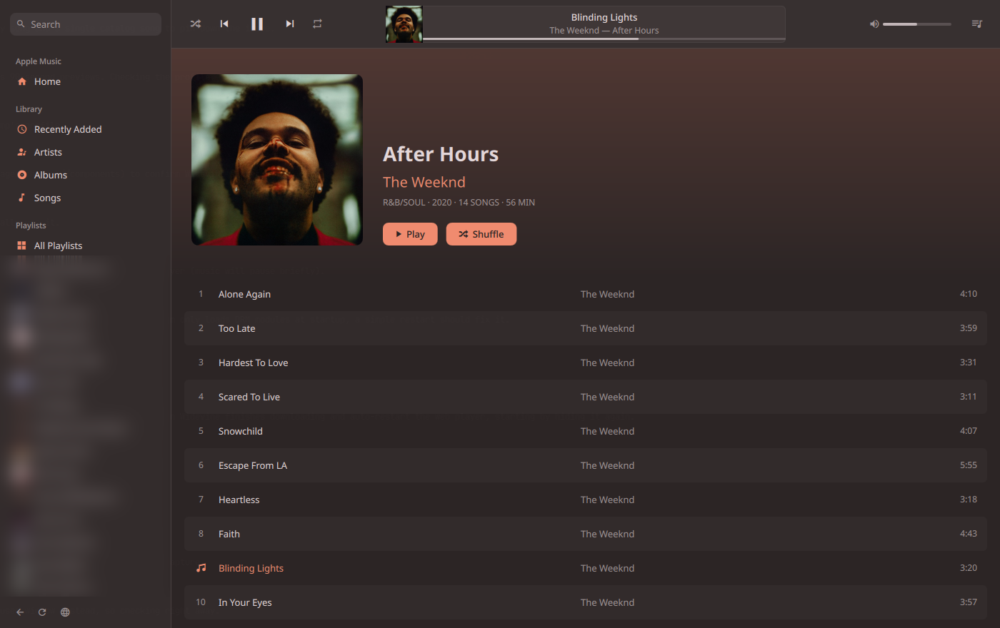
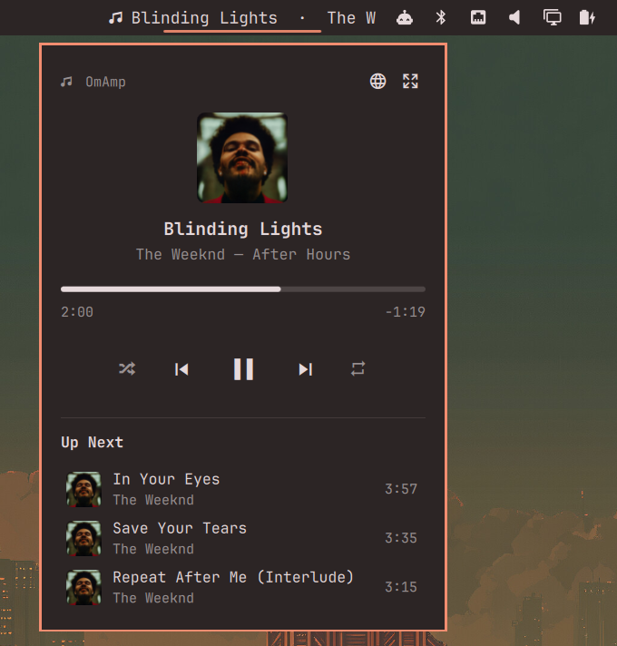

<p align="center">
  
</p>

<h1 align="center">OmAmp</h1>

Apple Music for the Omarchy bar. OmAmp puts the current song in your bar with a
slim popup for quick control, and pops out into a full player that looks and
works like Apple Music: library, playlists, search, album and artist pages, and
the Up Next queue. It follows your Omarchy theme colors live.





## Features

- **Bar widget:** play state and a scrolling title / artist.
- **Slim popup** (left-click): cover art, title, a draggable timeline (scroll
  to seek), shuffle / previous / play-pause / next / repeat, and the next three
  songs (click one to jump to it).
- **Pop-out player** (right-click, or the ⤢ button in the popup):
  - Home (recently played and recommendations), Recently Added, Artists,
    Albums, Songs, and all your playlists
  - Search across the Apple Music catalog or your library
  - Album, playlist and artist pages with Play / Shuffle
  - Up Next drawer, volume, shuffle and repeat
  - Right-click menu: Play, Shuffle, Play Next, Play Last
  - Keys: <kbd>Space</kbd> play/pause, <kbd>Ctrl</kbd>+<kbd>F</kbd> search,
    <kbd>Ctrl</kbd>+<kbd>←</kbd>/<kbd>→</kbd> previous/next,
    <kbd>Alt</kbd>+<kbd>←</kbd> back
- **Middle-click** the bar widget to play/pause.
- **IPC / keybindings:** `omarchy-shell omamp togglePopup` and
  `omarchy-shell omamp openPlayer`. The pop-out also accepts a page, e.g.
  `omarchy-shell shell summon io.github.v-eagle.omamp '{"search":"Daft Punk"}'`.

## Requirements

- Omarchy 4 (the Quickshell-based shell) on Hyprland 0.56+
- An Apple Music subscription
- `chromium` (preferred; `google-chrome-stable` or `brave` also work).
  Chromium downloads the Widevine DRM module Apple Music needs on first run.
- `python3` (standard library only)

## Install

```bash
omarchy plugin add https://github.com/V-EAGLE/omamp.git --enable
```

The widget appears on the right of your bar; move it with
`omarchy bar move io.github.v-eagle.omamp --section <left|center|right>`.

**First run:** click the widget and choose **Start Apple Music**. A web player
window opens; sign in to Apple Music there. Once you're signed in, OmAmp moves
that window to a hidden workspace (`special:applemusic`). The 🌐 button in the
popup or pop-out shows it again.

### Optional: launcher entry

To open the pop-out from the <kbd>Super</kbd>+<kbd>Space</kbd> menu by searching
"OmAmp", create a desktop entry (plugins can't install one themselves):

```bash
cat > ~/.local/share/applications/omamp.desktop <<EOF
[Desktop Entry]
Type=Application
Name=OmAmp
GenericName=Apple Music Player
Keywords=omamp;apple;music;player;
Exec=omarchy-shell shell summon io.github.v-eagle.omamp {}
Icon=$HOME/.config/omarchy/plugins/io.github.v-eagle.omamp/omamp.svg
Categories=AudioVideo;Audio;Player;
EOF
```

## How it works

There is no Apple Music app for Linux, so OmAmp runs
[music.apple.com](https://music.apple.com) as a Chromium web app and controls
it:

- `amctl.py` launches Chromium with its own profile and the DevTools protocol
  enabled on `127.0.0.1:9339`, then drives the page's MusicKit player (play,
  seek, queue, library and catalog requests).
- `Service.qml` runs `amctl.py` and shares the playback state with the bar
  widget (`BarWidget.qml`) and the pop-out window (`Player.qml`).

On the very first start Chromium downloads the Widevine DRM module in the
background; until it's loaded Apple Music only plays 90-second previews.
OmAmp detects this and restarts the web player once, automatically, as soon as
Widevine is available.

Chromium keeps running when the shell restarts, so playback isn't interrupted.
**Closing the web player window stops the music.**

## Security and privacy

- Plugins run unsandboxed inside the Omarchy shell.
- The Chromium DevTools port listens on `127.0.0.1:9339` only. It can't be
  reached from other machines, but any program running as your user can
  control that browser profile, including your signed-in Apple Music session.
- Your Apple Music sign-in is stored in a separate Chromium profile at
  `~/.local/share/omamp/chromium`. OmAmp sends nothing anywhere
  except Apple Music's own web player traffic.

## Limitations

- OmAmp relies on internals of Apple's web player, so an Apple update can
  break parts of it until OmAmp is updated.
- Lyrics, editing playlists and adding to your library aren't supported yet.

## Uninstall

```bash
omarchy plugin remove io.github.v-eagle.omamp
rm -rf ~/.local/share/omamp ~/.local/share/applications/omamp.desktop
```

## Disclaimer

OmAmp is an unofficial project and is not affiliated with, endorsed by or
sponsored by Apple Inc. Apple Music is a trademark of Apple Inc.

## License

[MIT](LICENSE)
